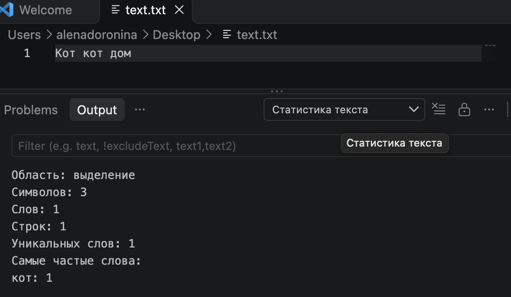
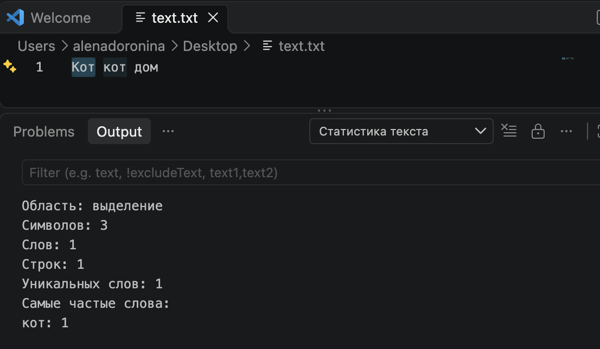

# Лабораторная работа №3. Создание плагина

**Студент:** Доронина Алена Андреевна   
**Группа:** М3117 
**IDE:** Visual Studio Code  
**Название плагина:** «Статистика текста»  
**Язык:** JavaScript  
**Репозиторий:** 

**Использование ИИ:** Codex (OpenAI) использовался для написания кода.

## 1. Цель работы

Изучить подключение дополнительных возможностей к среде разработки и реализовать плагин для Visual Studio Code.

## 2. Техническое задание

Плагин должен по команде анализировать выделенный текст или весь активный документ, если выделения нет. Результат должен содержать:

- количество символов, слов и строк;
- количество уникальных слов без учёта регистра;
- пять самых частых слов с количеством повторений.

Результаты выводятся в панели «Вывод». Исходный документ не изменяется. Для пустого текста выводятся нулевые показатели, а при отсутствии редактора появляется сообщение с предложением открыть файл.

Словом считается последовательность букв. Цифры и пунктуация словами не считаются, дефис разделяет слова. При подсчёте символов учитываются пробелы и переводы строк. Символы считаются по кодовым точкам Unicode.

## 3. Архитектура IDE и плагина

VS Code предоставляет API расширений для работы с документами, командами и интерфейсом. Описание плагина хранится в `package.json`: в нём указаны название, поддерживаемая версия редактора, основной файл и добавляемая команда.

Код данного расширения выполняется в Extension Host, среде запуска расширений VS Code. Через модуль `vscode` плагин получает текст документа и выводит результаты. При первом вызове команды расширение активируется, и функция `activate(context)` регистрирует её обработчик.

Плагин разделён на два модуля:

- `extension.js` регистрирует команду, получает текст и показывает результат;
- `analyzer.js` выполняет подсчёты и возвращает объект со статистикой.

Схема работы:

```text
Вызов команды
      ↓
Получение выделения или всего документа
      ↓
Анализ текста и подсчёт частот в Map
      ↓
Сортировка слов и выбор первых пяти
      ↓
Вывод результата
```

Если активного редактора нет, анализ не выполняется и показывается подсказка.

## 4. Разработка плагина

1. Создана папка `text-stats-lab` с исходниками, настройками и документацией.
2. В `package.json` объявлена команда `textStats.analyze` с названием «Статистика текста: анализировать» и указан основной файл `extension.js`.
3. В `.vscode/launch.json` добавлена конфигурация типа `extensionHost` для запуска проверочного окна VS Code.
4. В `extension.js` реализован обработчик команды. Он проверяет наличие редактора и получает основное выделение либо весь текст документа.
5. В `analyzer.js` реализована функция `analyzeText`. Она переводит текст в нижний регистр, выделяет слова и подсчитывает их частоты.
6. Результаты передаются в канал «Статистика текста» панели «Вывод». Перед повторным анализом предыдущий результат очищается.

Для хранения слов используется массив, для подсчёта повторений применяется `Map`: ключом является слово, значением является количество его появлений. Записи сортируются по убыванию частоты, а при равенстве частот по алфавиту. Затем выбираются первые пять слов.

В программе используются условия, цикл, регулярное выражение и сортировка. Таким образом, плагин обрабатывает входной текст с помощью алгоритма и структур данных.

## 5. Проверка работы

Для запуска необходимо открыть всю папку проекта в VS Code, выбрать конфигурацию «Запустить плагин» в разделе Run and Debug и запустить её. Во втором окне Extension Development Host нужно открыть текстовый документ и вызвать команду «Статистика текста: анализировать» через палитру команд.

| Проверка | Ожидаемый результат | Фактический результат |
|---|---|---|
| `Кот кот дом` без переноса в конце | 11 символов, 3 слова, 1 строка, 2 уникальных слова; кот: 2, дом: 1 | Получено 11 символов, 3 слова, 1 строка, 2 уникальных слова; кот: 2, дом: 1. Результат соответствует ожидаемому. |
| Выделено только `Кот` | 3 символа, 1 слово, 1 строка | Получено 3 символа, 1 слово, 1 строка. Результат соответствует ожидаемому. |
| Пустой документ | Все показатели равны нулю | Все показатели равны нулю. Выведено сообщение «Слов не найдено». |
| Нет активного редактора | Сообщение «Сначала открой текстовый файл» | Появилось сообщение «Сначала открой текстовый файл». Анализ не выполняется. |

Подготовлены пять автоматических тестов анализатора: пустой текст, частоты и регистр, Unicode и переносы строк, цифры и пунктуация, сортировка и ограничение списка пятью словами. Все пять тестов прошли при подготовке проекта. 





## 6. Документация и репозиторий

К функциям добавлены комментарии JSDoc с описанием назначения, параметров и результата.

В файле `README.md` указаны сведения об авторе, название и возможности плагина, а также порядок его запуска. Описание функций и алгоритма обработки текста приведено в `docs/DOCUMENTATION.md`.


## 7. Вывод

Разработан плагин «Статистика текста» для VS Code. Он получает текст через API редактора, вычисляет статистику и выводит результат в отдельной панели. Для подсчёта повторений используется Map, а вычисления отделены от взаимодействия с редактором. Автоматические тесты расчётов пройдены; Результаты проверки приведены в таблице и на скриншотах.
